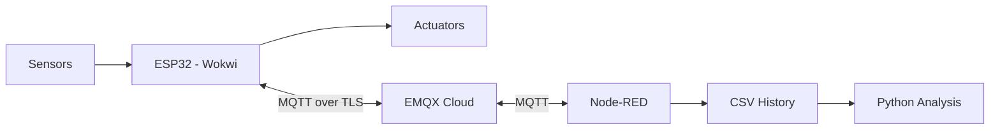

# Industrial IoT Motor Monitoring System

An Industrial Internet of Things (IIoT) prototype for
real-time motor condition monitoring, automated fault
detection, and remote actuator control.

Developed as an engineering project at ENSA Béni Mellal.

## Features

- Real-time temperature and vibration monitoring
- ESP32 embedded firmware development in C++
- Sensor data acquisition and validation
- Automated fault detection and actuator control
- Secure MQTT communication using TLS certificate validation
- Remote supervision through Node-RED
- Online/offline detection using MQTT Last Will
- Automatic Wi-Fi and MQTT reconnection
- Historical data collection and Python anomaly detection

## System Architecture

## Technologies

| Technology | Purpose |
|------------|---------|
| ESP32 | Embedded processing |
| DHT22 | Temperature measurement |
| MPU6050 | Vibration estimation |
| C++ | Embedded firmware |
| Wokwi | Hardware simulation |
| MQTT | Bidirectional communication |
| EMQX Cloud | MQTT broker |
| TLS | Secure communication |
| Node-RED | Supervision and remote control |
| Python | Data analysis and anomaly detection |

## MQTT Topics

| Topic | Description |
|-------|-------------|
| `factory/motor/temperature` | Temperature measurements |
| `factory/motor/vibration` | Vibration measurements |
| `factory/motor/status` | Online/offline status |
| `factory/motor/command` | Remote actuator commands |

## Security and Reliability

- TLS encryption on port 8883
- CA certificate validation
- MQTT authentication
- Input data validation
- Automatic connection recovery
- MQTT Last Will and Testament

Sensitive credentials are excluded from this repository.

## Python Anomaly Detection

Historical sensor measurements are exported from Node-RED
to CSV files and analyzed using Python.

The analysis combines fixed thresholds with rolling
statistical indicators to identify abnormal operating
conditions and visualize sensor trends.

## Demonstrations

- [Wokwi Simulation](https://wokwi.com/projects/477604647717561345)
- [Real-time Monitoring and Alerts](https://drive.google.com/file/d/1Nk9ydJ1HV6bzP4FwF-uL7qwq2E8-8Lgy/view)
- [Automatic Actuator Control](https://drive.google.com/file/d/1MAHuqHyy3Fiy0ahmeSubEsMpgv0Dp4py/view)
- [Remote Control - Node-RED](https://drive.google.com/file/d/1BD3VBb0UIVviV0W_BeQZEqwixBbgHHRn/view)
- [Remote Control - Wokwi](https://drive.google.com/file/d/14QPg-sFNC72qD4SSSclE-ken7wgEloJ6/view)

## Project Contributors

Academic team project — Industrial Digital Transformation
Engineering, ENSA Béni Mellal (2026).

Supervised by Prof. TOUIL.
